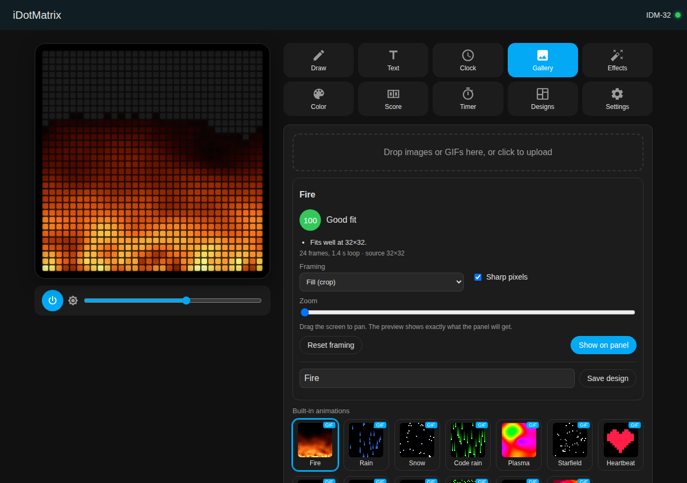

# iDotMatrix Studio for Home Assistant

> **Control iDotMatrix Bluetooth pixel displays from Home Assistant, with an app-style sidebar panel for drawing, text, clocks, GIFs and effects. No phone app or cloud.**

For Home Assistant users with an iDotMatrix LED panel (16×16, 32×32 or 64×64). It adds a sidebar
page that works like the phone app: draw live on the panel, upload images and GIFs with an exact
LED preview and a "will this fit at 32×32?" check, show text, clocks, effects, a scoreboard or
timers, and save any of it as a design you can pick from automations or HomeKit.

  
   
  <em>The gallery previews exactly the frames the panel will receive.</em>

## Installation

You need Home Assistant 2025.1 or newer with a Bluetooth adapter (or ESPHome Bluetooth proxy)
in range of the panel.

| Method | Install |
|---|---|
| [HACS](https://hacs.xyz) | HACS → ⋮ → **Custom repositories** → add `https://github.com/DanielHou315/iDotMatrix-Studio-HomeAssistant` as an **Integration**, then install **iDotMatrix Studio** and restart Home Assistant |
| Manual | Download `custom_components/idm_studio` from the [latest release](https://github.com/DanielHou315/iDotMatrix-Studio-HomeAssistant/releases/latest) into `<config>/custom_components/` and restart Home Assistant |

Then **Settings → Devices & services → Add integration → iDotMatrix Studio**. Panels are also
discovered automatically. Close the phone app first: the panel accepts one connection at a time.
Pick the panel's real size during setup (or later under **Configure**): a wrong size can crash
the panel when it shows text.

## Features

- **Draw**: paint on a 32×32 grid with pen, eraser, fill and colour picker; strokes appear on the
  panel live.
- **Gallery**: upload images or GIFs (drag and drop), frame them with fill, fit, zoom, pan and
  sharp or smooth scaling, and preview the exact result. A fit score warns when detail will be
  lost at panel resolution. Ships with 13 original animations.
- **Text, Clock, Effects, Color, Score, Timer**: the panel's built-in modes.
- **Designs**: save anything above and replay it from the panel, the `Design` select entity,
  automations, or HomeKit (the select is bridged as one switch per design).

## Reference

**Entities**: `light` (power, brightness), `select` (saved designs), `button` (sync clock).

**Actions** (all take an optional `config_entry_id` when you have several panels)

| Action | Purpose |
|---|---|
| `idm_studio.text` | Scrolling or animated text |
| `idm_studio.clock` | Clock face, style 0-7 |
| `idm_studio.color` | Fill the panel with one colour |
| `idm_studio.effect` | Built-in effect with 2-7 colours |
| `idm_studio.image` / `idm_studio.gif` | Show a file from an allowed path |
| `idm_studio.media` | Show a gallery item with framing |
| `idm_studio.design` | Replay a saved design by name or id |
| `idm_studio.scoreboard`, `.countdown`, `.stopwatch` | Panel timers and scores |
| `idm_studio.sync_time`, `.clear` | Housekeeping |

More detail lives in [`docs/`](docs/README.md).

## Contributing

Issues and pull requests are welcome; see [`CONTRIBUTING.md`](CONTRIBUTING.md) for setup, checks
and the release process, and [`CHANGELOG.md`](CHANGELOG.md) for what changed. Humans and agents
follow the same rules, kept in [`AGENTS.md`](AGENTS.md).

## License

[GPL-3.0](LICENSE), matching the projects the protocol was learned from.

## Acknowledgements

The BLE protocol follows [derkalle4/python3-idotmatrix-library](https://github.com/derkalle4/python3-idotmatrix-library)
and [tukies/iDotMatrix-HomeAssistant](https://github.com/tukies/iDotMatrix-HomeAssistant), and
[8none1/idotmatrix](https://github.com/8none1/idotmatrix) for the reverse engineering. The
Engineering Principles in `AGENTS.md` are adapted from
[Karpathy-inspired coding guidelines](https://github.com/forrestchang/andrej-karpathy-skills).

This project is not affiliated with the makers of iDotMatrix.
